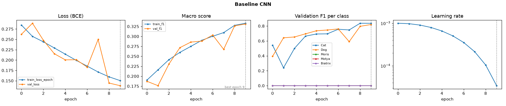
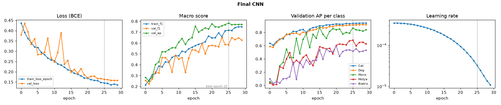
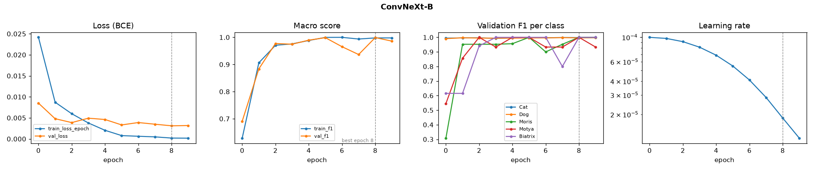
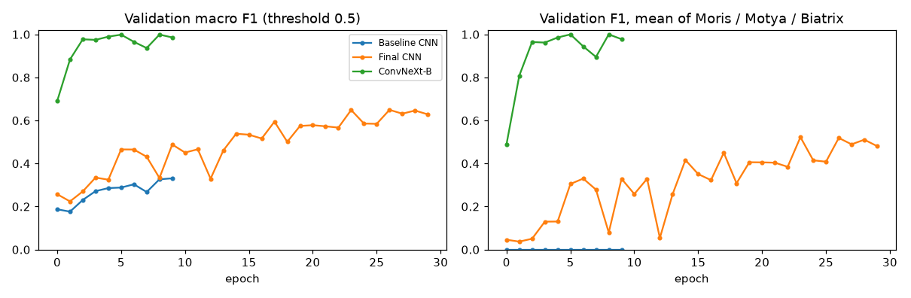
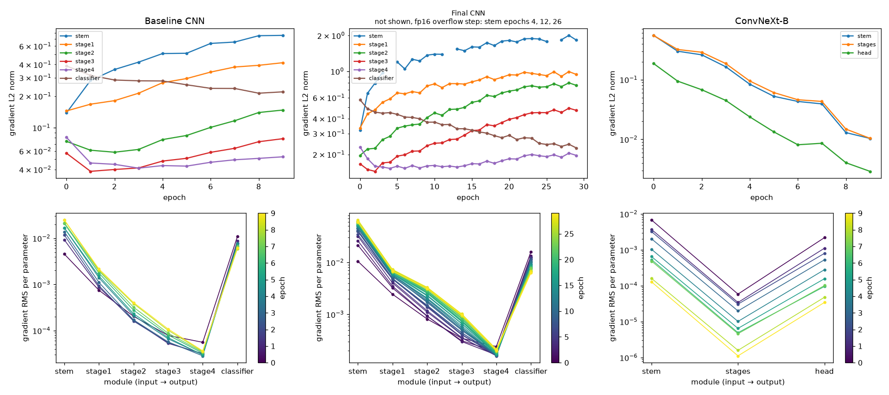
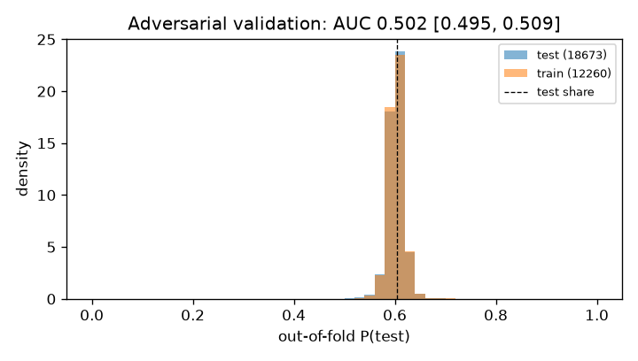
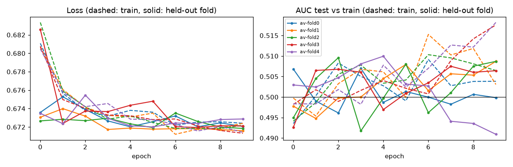
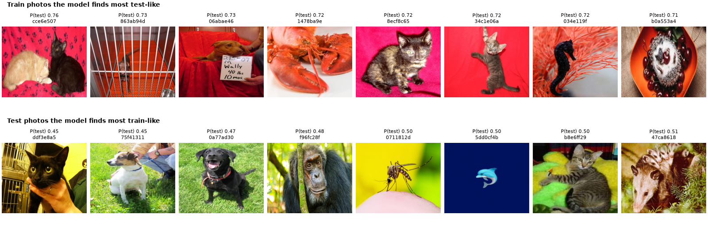
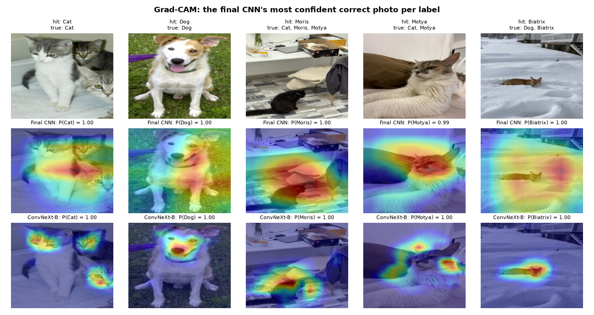
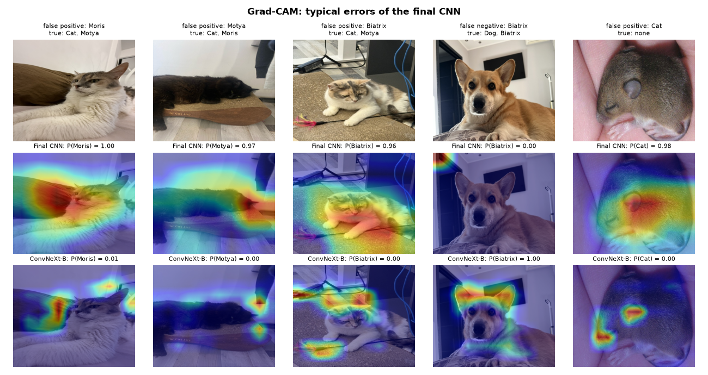

# CNN for multilabel classification

Kaggle [cats-and-dogs](https://www.kaggle.com/competitions/cats-and-dogs) ("Cats and Dogs++").
Each photo has 5 binary labels: **Cat, Dog, Moris, Motya, Biatrix**. Moris and Motya are two particular cats and Biatrix is a particular dog. The metric is **macro F1** over the 5 labels.

The code is PyTorch Lightning with timm and albumentations; every run is tracked in MLflow.
This README is the project report:
- what the data looks like;
- how we validate;
- which models and hyper-parameters we tried, and what each scored on validation and on the public leaderboard (LB);
- training curves, gradient flow, Grad-CAM, adversarial validation.

## Results at a glance

"Val" is fold 0 of our 5-fold split: 2,452 photos never trained on. Section 3 explains why it is noisier than the LB.

| Model | Parameters | Val macro F1 @0.5 | Val macro AP | Val F1 after post-processing | Public LB, raw | Public LB, post-processed |
|---|---|---|---|---|---|---|
| Baseline custom CNN (run `86ea605c`) | 2.80 M | 0.331 | – | 0.547 | 0.324 | 0.445 |
| Final custom CNN, `final1-fold0` (best of the sweep) | 1.23 M | 0.584 | 0.784 | 0.735 (tuned thresholds) | 0.59173 | – |
| ConvNeXt-B, ImageNet-22k pretrained (run `b4bddc3f`) | 87.6 M | 0.9990 | 1.000 (TTA) | 0.9995 | 0.97266 | 0.98045; **0.98060** with allowed combinations |
| Ensemble of the two, w = 0.725 on ConvNeXt-B (val at w ≈ 0.7) | 88.8 M | 0.9992 | 0.9998 | 0.9996 | – | 0.97287 |

AP was not logged for the baseline. On 25.10 the team is 3rd on the public LB with 0.98060; 1st place has 0.98401.

## 1. Data

From `notebooks/EDA.ipynb`.

**Images**
- 12,260 train and 18,673 test photos.
- Every file is a 450×375 RGB JPEG with no EXIF. None is missing or corrupt.

**Labels**

| | Cat | Dog | Moris | Motya | Biatrix | no label |
|---|---|---|---|---|---|---|
| train photos | 5,077 | 5,025 | 56 | 42 | 41 | 2,162 |
| share | 41.4% | 41.0% | 0.5% | 0.3% | 0.3% | 17.6% |

**Only 8 label combinations occur:**

| Combination | Photos |
|---|---|
| Cat | 4,989 |
| Dog | 4,984 |
| none | 2,162 |
| Cat + Moris | 42 |
| Dog + Biatrix | 37 |
| Cat + Motya | 32 |
| Cat + Moris + Motya | 10 |
| Cat + Dog + Moris + Biatrix | 4 |

- A named animal always comes with its species: no Moris or Motya without Cat, no Biatrix without Dog.
- Cat and Dog appear together only in the 4 Moris + Biatrix photos.
- The 2,162 unlabelled photos show other animals, objects and logos. They are kept as negatives.

**Near-duplicates (perceptual hash, pHash)**
- 31 exact duplicate pairs, none with conflicting labels.
- 438 test photos have a train photo within Hamming distance 6, and 430 of them within 2.
- Up to distance 6, no two train duplicates disagree on labels.
- At distance 6 a few matches are false (a dog with a moth, a beetle with a fly).
- Near-duplicates form groups of at most 4 photos.

**Train vs test**
- File size: mean 56.99 KB in train, 56.89 KB in test.
- Brightness: median 0.462 vs 0.464.
- Contrast: 0.216 in both.
- So no shift is visible in simple statistics. Section 9 confirms this with a model: test and train photos cannot be told apart (AUC 0.502).

**The named animals are the whole game**
- They make up 3 of the 5 labels in macro F1, but only 125 train photos (139 labels: 14 photos show two of them).
- On the public LB one wrong named-animal photo costs about 0.001–0.002 macro F1, while one wrong Cat/Dog photo costs about 0.00003.
- Moris and Motya share indoor backgrounds. Biatrix also appears outdoors and in a car.
- From ConvNeXt-B's predicted probabilities, the test set has about twice the train share of named animals: the probabilities sum to 164 / 130 / 170 Moris / Motya / Biatrix photos, against 85 / 64 / 62 at the train share.

## 2. Preprocessing and feature engineering

Inputs are raw pixels, so the "features" are learned. The engineering is in the input pipeline, the loss and the post-processing.

**Resize**
- Each photo is resized (squashed, not cropped) to 224×224 for the custom CNNs and to 384×384 for ConvNeXt-B.
- For the sweep and the final CNN, the 224 px images were decoded once into a uint8 `.npy` cache (`build_cache` in `src/data.py`); augmentations run on the cached images.

**Normalisation**
- Custom CNNs: per-channel mean and std computed on the training folds only, e.g. mean [0.4889, 0.4623, 0.42] and std [0.265, 0.2573, 0.2631] for fold 0.
- ConvNeXt-B: ImageNet statistics.

**Augmentation** (`train_transforms` in `src/data.py`)
- RandomResizedCrop (scale 0.9–1, ratio 1–1.4).
- Horizontal flip.
- Affine: ±10% shift, ±15° rotation, p 0.5.
- Brightness/contrast, p 0.5.
- With p 0.2, one of: JPEG quality 50–95, Gaussian blur, motion blur, downscale or Gaussian noise.
- Deliberately not used: grayscale, hue/saturation and colour jitter, because coat colour is what tells Moris from Motya. Vertical flips, 90° rotations and elastic or grid distortions are not used either, since photos are always upright.

**Class imbalance**
- `BCEWithLogitsLoss` with `pos_weight = sqrt(negatives / positives)` per class: [1.19, 1.20, 14.73, 16.96, 17.48] on folds 1–4.
- Chosen by the sweep: the plain ratio (up to 300) was never tried; sqrt beat none.

**Post-processing** (`src/postprocess.py`, applied in this order)
1. **TTA**: average of the original and the horizontally flipped photo.
2. **pHash similarity layer**: if a test photo has train photos within distance 2, `p ← (1 − λ)·p + λ·(their mean label)`, with λ = 0.5.
3. **Per-class thresholds**: best F1 on fold 0 over a 0.05–0.95 grid.
4. **Label hierarchy**: a predicted named animal adds its species.
   - Branch `combos` has an alternative: the most probable of the 8 combinations seen in train. For ConvNeXt-B it scores 0.98060 on the public LB, against 0.98045 with the hierarchy.

What each step did on val:

| Step | Baseline CNN, val macro F1 | ConvNeXt-B, val macro F1 |
|---|---|---|
| model, threshold 0.5 | 0.3312 | 0.9990 |
| + TTA hflip | 0.3321 | 0.9993 |
| + pHash ≤ 2, λ = 0.5 | 0.3737 | 0.9993 |
| + per-class thresholds | 0.5474 | 0.9995 |
| + hierarchy | 0.5467 | 0.9995 |
| **public LB** | 0.324 → **0.445** | 0.97266 → **0.98045** (0.98060 with combinations) |

**Notes on the steps**
- **Thresholds** do most of the work.
  - The baseline never puts a named animal above 0.5, so its thresholds are low (Motya 0.05).
  - The final CNN, trained with `pos_weight`, over-predicts the named animals, so its thresholds are high: Moris 0.95, Motya 0.85, Biatrix 0.80.
- **The pHash layer** helps the baseline on val (+0.04) but changes nothing for ConvNeXt-B on test.
  - On val it works because the folds are not grouped by pHash (section 3): 56 val photos have a near-copy (pHash ≤ 6) in the training folds. That is the same situation as the 430 test photos with a copy in train.
  - On all 430 of those test photos, ConvNeXt-B already agrees with the copy's label.

## 3. Validation

**Split** (`src/split.py`)
- `MultilabelStratifiedKFold`, 5 folds, seed 42.
- Each fold has 2,452 photos: about 1,015 Cat, 1,005 Dog and only **11 Moris, 8 Motya and 9 Biatrix**.
- Every model is trained on folds 1–4 and validated on fold 0. The two final sweep configurations were also trained on fold 1.

**Consequences for reading the numbers**
- **Val macro F1 is noisy.**
  - One named-animal photo moves val macro F1 by about 0.01, ten times its weight on the LB.
  - ConvNeXt-B's val F1 jumps between 0.937 and 0.999 over epochs 6–10.
  - The same final CNN configuration gets val AP 0.784 on fold 0 and 0.751 on fold 1.
- **Model selection uses macro AP.** It doesn't depend on a threshold, so it is more stable.
- **Tuned-threshold F1 is optimistic,** because the thresholds are fitted on the same fold they are scored on.
- **Near-duplicates can cross folds.** The folds are not grouped by pHash, although the EDA recommended `StratifiedGroupKFold`.
  - 326 train photos have a train near-duplicate (pHash ≤ 6), in 163 groups.
  - 130 of those groups are split across folds, so 56 val (fold 0) photos have a near-copy in the training folds.
  - This makes CV slightly optimistic: 56 of 2,452 photos.
- **CV vs LB.** Val ranks the single models the same way as the LB: baseline 0.331 vs 0.324, final CNN 0.584 vs 0.592, ConvNeXt-B 0.9990 vs 0.97266.
  - For the custom CNNs, val F1 at 0.5 matches the LB within 0.01.
  - For the strong model, val is higher than the LB. Val cannot rank the ensemble against ConvNeXt-B either (section 11).
  - The most likely reason is the larger share of named animals in the test set: they are where ConvNeXt-B still errs.
  - Adversarial validation (section 9) finds no difference between train and test photos (AUC 0.502), so the gap is not a change in the images.

## 4. Models

### Custom CNN (`src/cnn.py`)

A ResNet-style network:

```
stem      Conv3x3 s2 (3→w) + BN + ReLU, MaxPool 3x3 s2         224 → 56
stage1    residual blocks, w   → w     (stride 1)               56
stage2    residual blocks, w   → 2w    (stride 2, 1x1 shortcut) 28
stage3    residual blocks, 2w  → 4w    (stride 2, 1x1 shortcut) 14
stage4    residual blocks, 4w  → 8w    (stride 2, 1x1 shortcut)  7
head      global average pool → Dropout → Linear(8w → 5), sigmoid per label
```

A residual block is Conv3x3–BN–ReLU–Conv3x3–BN, plus the shortcut, then ReLU.

- **Baseline:** w = 32, 2 blocks per stage, dropout 0.2: 2,796,325 parameters.
  - AdamW, lr 1e-3 with cosine decay to 1e-5, weight decay 1e-4, batch 64, 10 epochs, no `pos_weight`.
  - Best checkpoint by val F1.
- **Final** (sweep trial 28, `src/best_model.py`, details in `docs/FINAL_MODEL.md`): w = 32, **1 block per stage**, dropout 0.191: 1,227,685 parameters.
  - AdamW, lr 3.47e-4 with cosine decay to 1e-5, weight decay 1.18e-3, `pos_weight` sqrt, batch 64, 30 epochs, fp16.
  - Best checkpoint by val AP: epoch 25.

### Transfer learning (`src/pretrained.py`)

ConvNeXt-B `convnext_base.fb_in22k_ft_in1k_384` from timm (ImageNet-22k, then fine-tuned on 1k at 384 px).
- New 5-way head, drop-path 0.1.
- 384 px input, batch 16.
- AdamW, lr 1e-4 with cosine decay to 1e-5, weight decay 1e-4, 10 epochs.
- Best checkpoint by val F1: epoch 8.

## 5. Hyper-parameter search (`src/sweep.py`, `notebooks/sweep.ipynb`)

**Setup**
- Colab T4, cached 224 px images, fp16, seed 42.
- Fold 0, scored by best-epoch **val macro AP**.
- The baseline configuration is the reference point.

**Stages**
- **Stage A, one-factor ablations,** 12 epochs each.
- **Stage B, Optuna:**
  - TPE sampler (seed 42), median pruner (5 startup trials, 3 warm-up epochs), 10 epochs per trial, 2.2 h budget.
  - Trial 0 is the baseline.
  - 32 trials ran: 15 completed, 17 pruned.
  - The search space:

    | Parameter | Values |
    |---|---|
    | base width w | 32 / 48 / 64 |
    | blocks per stage | shallow [1,1,1,1] / base [2,2,2,2] / deep [2,3,4,2] |
    | activation | ReLU / SiLU |
    | dropout | U[0, 0.5] |
    | lr | log-U[3e-4, 5e-3] |
    | weight decay | log-U[1e-5, 1e-2] |
    | `pos_weight` | none / sqrt |
- **Stage C, final:** the 2 best completed trials (28 and 11), retrained for 30 epochs on fold 0 and on fold 1. Test predictions were saved.

### Stage A: ablations (12 epochs, val fold 0)

| Run | Change from baseline | Best epoch | Val AP | Val F1 @0.5 | Val F1 tuned |
|---|---|---|---|---|---|
| A-base | – (w 32, 2 blocks, lr 1e-3, wd 1e-4, no pos_weight) | 10 | 0.4886 | 0.3290 | 0.4278 |
| A-lr-3e-4 | lr 3e-4 | 9 | **0.5927** | 0.4033 | 0.6084 |
| A-lr-3e-3 | lr 3e-3 | 10 | 0.4214 | 0.3055 | 0.4238 |
| A-wd-1e-2 | weight decay 1e-2 | 11 | 0.4861 | 0.3370 | 0.5020 |
| A-posweight-sqrt | `pos_weight` sqrt | 10 | 0.5041 | 0.3820 | 0.5213 |
| A-no-batchnorm | no BatchNorm (convs get a bias) | 11 | 0.3581 | 0.2852 | 0.3604 |

**What the ablations show**
- **Learning rate matters most:** 3e-4 adds +0.10 AP.
- **BatchNorm is essential:** without it, −0.13 AP.
- **`pos_weight` sqrt helps** the rare classes: +0.016 AP, +0.05 F1 @0.5.
- **Weight decay of 1e-2** changes nothing.

### Stage B: Optuna, best completed trials (10 epochs)

| Trial | w / blocks | Act. | Dropout | lr | wd | `pos_weight` | Val AP | Val F1 @0.5 | Val F1 tuned |
|---|---|---|---|---|---|---|---|---|---|
| **B-028** | 32 / shallow | ReLU | 0.191 | 3.47e-4 | 1.18e-3 | sqrt | **0.7062** | 0.5205 | 0.6342 |
| B-011 | 48 / shallow | ReLU | 0.216 | 3.50e-4 | 1.08e-3 | sqrt | 0.6581 | 0.5305 | 0.6361 |
| B-026 | 48 / shallow | ReLU | 0.166 | 3.01e-4 | 5.93e-4 | sqrt | 0.6487 | 0.5495 | 0.6343 |
| B-008 | 48 / shallow | ReLU | 0.054 | 3.28e-4 | 8.11e-4 | sqrt | 0.6444 | 0.5086 | 0.6522 |
| B-020 | 48 / shallow | ReLU | 0.074 | 3.93e-4 | 7.51e-3 | sqrt | 0.6402 | 0.4581 | 0.5931 |
| B-000 (baseline) | 32 / base | ReLU | 0.2 | 1e-3 | 1e-4 | none | 0.4307 | 0.3280 | 0.4190 |

All 32 trials are in the full table in section 6.

**What the search found**
- **Every good trial** is shallow, ReLU, lr about 3–4e-4 and `pos_weight` sqrt.
- **Depth:** with a 10-epoch budget, 1 block per stage beat 2 per stage and the deep [2,3,4,2] variant. A smaller network probably fits 10k photos faster and overfits less.
- **SiLU and the deep variant** were never competitive.
- **Wide, high-lr trials** (w 64, lr > 1e-3) were the worst completed ones.

### Stage C: final runs (30 epochs)

| Run | Configuration | Fold | Best epoch | Val AP | Val F1 @0.5 | Val F1 tuned | Public LB |
|---|---|---|---|---|---|---|---|
| **final1-fold0** | trial 28 | 0 | 25 | **0.7836** | 0.5843 | 0.7346 | 0.59173 (threshold 0.5) |
| final2-fold0 | trial 11 | 0 | 28 | 0.7705 | 0.6384 | 0.7363 | – |
| final1-fold1 | trial 28 | 1 | 27 | 0.7512 | 0.5917 | 0.7291 | – |
| final2-fold1 | trial 11 | 1 | 28 | 0.7080 | 0.5746 | 0.6868 | – |

- **Training longer helps:** 30 epochs instead of 10 adds +0.08 AP for trial 28.
- **Fold matters:** the same configuration differs by 0.03–0.06 AP between folds 0 and 1, which is as large as the gap between the top trials.
- **final1-fold0 per class** (AP / F1 at 0.5):
  - Cat 0.938 / 0.861
  - Dog 0.914 / 0.835
  - Moris 0.866 / 0.468
  - Motya 0.683 / 0.432
  - Biatrix 0.517 / 0.324
- **Exact match** (all 5 labels right) is 0.804.
- **Biatrix is the hardest class:** the dog appears in the most varied settings.

## 6. All experiments: CV and LB

"CV" is val fold 0, or fold 1 where the run name says so. LB is the public leaderboard. Only the runs in the first table were submitted; the sweep runs were scored on validation only.

| Experiment | Val macro F1 @0.5 | Val after post-processing | Val macro AP | Public LB |
|---|---|---|---|---|
| Baseline CNN `86ea605c` | 0.3312 | 0.5467 | – | 0.32430 raw / 0.44517 post |
| Final CNN `final1-fold0` | 0.5843 | 0.7346 (tuned thresholds, not submitted) | 0.7836 | 0.59173 (threshold 0.5) |
| ConvNeXt-B `b4bddc3f` | 0.9990 | 0.9995 | 1.0000 (TTA) | 0.97266 raw / 0.98045 post |
| ConvNeXt-B, allowed combinations instead of the hierarchy (branch `combos`) | – | – | – | **0.98060** |
| Ensemble, w = 0.725, probability average | 0.9992 | 0.9996 (tuned thresholds + hierarchy) | 0.9998 | 0.97287 |

<details>
<summary>Every sweep run (42 runs, val only, sorted by val AP)</summary>

Pruned trials stopped early. Their width and depth are inferred from the parameter count.

| Run | Status | w / blocks | Act. | Dropout | lr | wd | `pos_weight` | Best epoch | Val AP | Val F1 @0.5 | Val F1 tuned |
|---|---|---|---|---|---|---|---|---|---|---|---|
| final1-fold0 | done | 32 / shallow | relu | 0.191 | 3.47e-4 | 1.18e-3 | sqrt | 25 | 0.7836 | 0.5843 | 0.7346 |
| final2-fold0 | done | 48 / shallow | relu | 0.216 | 3.50e-4 | 1.08e-3 | sqrt | 28 | 0.7705 | 0.6384 | 0.7363 |
| final1-fold1 | done | 32 / shallow | relu | 0.191 | 3.47e-4 | 1.18e-3 | sqrt | 27 | 0.7512 | 0.5917 | 0.7291 |
| final2-fold1 | done | 48 / shallow | relu | 0.216 | 3.50e-4 | 1.08e-3 | sqrt | 28 | 0.7080 | 0.5746 | 0.6868 |
| B-028 | done | 32 / shallow | relu | 0.191 | 3.47e-4 | 1.18e-3 | sqrt | 9 | 0.7062 | 0.5205 | 0.6342 |
| B-011 | done | 48 / shallow | relu | 0.216 | 3.50e-4 | 1.08e-3 | sqrt | 8 | 0.6581 | 0.5305 | 0.6361 |
| B-026 | done | 48 / shallow | relu | 0.166 | 3.01e-4 | 5.93e-4 | sqrt | 8 | 0.6487 | 0.5495 | 0.6343 |
| B-008 | done | 48 / shallow | relu | 0.054 | 3.28e-4 | 8.11e-4 | sqrt | 8 | 0.6444 | 0.5086 | 0.6522 |
| B-020 | done | 48 / shallow | relu | 0.074 | 3.93e-4 | 7.51e-3 | sqrt | 9 | 0.6402 | 0.4581 | 0.5931 |
| B-015 | done | 48 / shallow | relu | 0.487 | 3.79e-4 | 3.81e-3 | sqrt | 8 | 0.6389 | 0.5283 | 0.6251 |
| B-013 | done | 48 / shallow | relu | 0.045 | 3.70e-4 | 1.44e-3 | sqrt | 9 | 0.6330 | 0.4453 | 0.6062 |
| B-016 | done | 48 / shallow | relu | 0.345 | 3.27e-4 | 4.16e-3 | sqrt | 9 | 0.6042 | 0.4535 | 0.6028 |
| A-lr-3e-4 | done | 32 / base | relu | 0.2 | 3e-4 | 1e-4 | none | 9 | 0.5927 | 0.4033 | 0.6084 |
| B-010 | done | 48 / shallow | relu | 0.378 | 6.01e-4 | 1.5e-5 | sqrt | 8 | 0.5577 | 0.5048 | 0.5660 |
| B-005 | done | 32 / shallow | silu | 0.194 | 6.44e-4 | 3.06e-3 | none | 9 | 0.5489 | 0.3200 | 0.5452 |
| A-posweight-sqrt | done | 32 / base | relu | 0.2 | 1e-3 | 1e-4 | sqrt | 10 | 0.5041 | 0.3820 | 0.5213 |
| A-base | done | 32 / base | relu | 0.2 | 1e-3 | 1e-4 | none | 10 | 0.4886 | 0.3290 | 0.4278 |
| A-wd-1e-2 | done | 32 / base | relu | 0.2 | 1e-3 | 1e-2 | none | 11 | 0.4861 | 0.3370 | 0.5020 |
| B-017 | pruned | 48 / shallow | silu | 0.468 | 3.84e-4 | 2.20e-4 | sqrt | 5 | 0.4794 | 0.3886 | 0.4739 |
| B-002 | done | 32 / base | silu | 0.070 | 6.82e-4 | 1.26e-4 | sqrt | 9 | 0.4767 | 0.3854 | 0.4879 |
| B-001 | done | 48 / shallow | silu | 0.301 | 2.20e-3 | 1.2e-5 | none | 8 | 0.4606 | 0.2979 | 0.4872 |
| B-027 | pruned | 48 / shallow | silu | 0.191 | 3.29e-4 | 3.92e-4 | sqrt | 5 | 0.4572 | 0.4035 | 0.4927 |
| B-000 (baseline) | done | 32 / base | relu | 0.2 | 1e-3 | 1e-4 | none | 9 | 0.4307 | 0.3280 | 0.4190 |
| A-lr-3e-3 | done | 32 / base | relu | 0.2 | 3e-3 | 1e-4 | none | 10 | 0.4214 | 0.3055 | 0.4238 |
| B-014 | pruned | 48 / shallow | relu | 0.076 | 9.14e-4 | 1.85e-4 | sqrt | 5 | 0.4214 | 0.3591 | 0.4681 |
| B-004 | done | 64 / base | relu | 0.260 | 1.40e-3 | 3.6e-5 | none | 9 | 0.3957 | 0.3071 | 0.4078 |
| B-030 | pruned | 32 / shallow | silu | 0.279 | 3.77e-4 | 6.62e-4 | sqrt | 2 | 0.3623 | 0.3231 | 0.4016 |
| B-022 | pruned | 48 / shallow | relu | 0.099 | 5.01e-4 | 4.14e-3 | sqrt | 3 | 0.3592 | 0.3325 | 0.3945 |
| A-no-batchnorm | done | 32 / base, no BN | relu | 0.2 | 1e-3 | 1e-4 | none | 11 | 0.3581 | 0.2852 | 0.3604 |
| B-003 | done | 64 / base | silu | 0.483 | 2.92e-3 | 8.2e-5 | sqrt | 9 | 0.3508 | 0.2962 | 0.4047 |
| B-029 | pruned | 32 / shallow | relu | 0.170 | 3.75e-4 | 3.58e-3 | sqrt | 2 | 0.3470 | 0.3742 | 0.4490 |
| B-012 | pruned | 48 / shallow | relu | 0.258 | 5.11e-4 | 4.59e-4 | sqrt | 2 | 0.3436 | 0.2955 | 0.3942 |
| B-019 | pruned | 48 / shallow | relu | 0.366 | 6.12e-4 | 7.17e-3 | sqrt | 3 | 0.3401 | 0.2949 | 0.3723 |
| B-021 | pruned | 48 / shallow | relu | 0.016 | 7.84e-4 | 6.79e-3 | sqrt | 3 | 0.3260 | 0.3347 | 0.3629 |
| B-007 | pruned | 64 / shallow | silu | 0.365 | 1.80e-3 | 4.59e-3 | none | 3 | 0.3243 | 0.2325 | 0.3557 |
| B-024 | pruned | 48 / shallow | relu | 0.126 | 1.47e-3 | 3.15e-3 | sqrt | 3 | 0.3225 | 0.3121 | 0.3901 |
| B-006 | pruned | 64 / base | relu | 0.408 | 2.19e-3 | 1.54e-3 | none | 3 | 0.3198 | 0.2424 | 0.3173 |
| B-031 | pruned | 32 / shallow | relu | 0.335 | 5.17e-4 | 1.43e-3 | sqrt | 2 | 0.3167 | 0.3105 | 0.3801 |
| B-025 | pruned | 48 / base | relu | 0.012 | 4.32e-4 | 7.87e-3 | sqrt | 3 | 0.2729 | 0.2773 | 0.3405 |
| B-009 | pruned | 32 / shallow | relu | 0.465 | 2.91e-3 | 7.95e-4 | none | 2 | 0.2611 | 0.1264 | 0.2466 |
| B-023 | pruned | 48 / deep | relu | 0.139 | 4.11e-4 | 8.1e-5 | sqrt | 3 | 0.2587 | 0.2143 | 0.2896 |
| B-018 | pruned | 48 / deep | relu | 0.103 | 5.96e-4 | 1.24e-3 | sqrt | 0 | 0.2448 | 0.1649 | 0.2997 |

</details>

## 7. Training curves (`src/figures.py`)

The curves come from the MLflow runs of the baseline and ConvNeXt-B and from the export of the final CNN (`results/final_model/`).

The x axis is the 0-based epoch, as in checkpoint names, and the dashed line marks the kept checkpoint.






**Baseline CNN**
- Train and val loss fall together, and val loss is still falling at epoch 9, so the model is under-trained, not over-fitted.
- Its F1 for Moris, Motya and Biatrix is 0 at every epoch. Without `pos_weight`, their probabilities never reach 0.5, so macro F1 is capped near (F1_Cat + F1_Dog) / 5 ≈ 0.33.

**Final CNN**
- Val AP climbs steadily to 0.78 around epoch 20–25, then flattens as the cosine schedule drives the lr towards 1e-5.
- Train loss keeps falling (0.137 at the end) while val loss levels off at 0.158. That is a small generalisation gap and not severe over-fitting.
- Val F1 at 0.5 zig-zags much more than AP. With `pos_weight`, named-animal probabilities sit near the threshold, and only 8–11 positives per class decide the score.
- Losses use `pos_weight`, so they are not comparable with the baseline's.

**ConvNeXt-B**
- The pretrained features make it converge in 2 epochs: val F1 0.97.
- Train loss then drops to 0.0002 while val loss stays at about 0.003, so it memorises the training set.
- Its val F1 moves by single named photos: 0.937–0.999.

## 8. Gradient flow (`src/figures.py`)

The classifier logs the L2 norm of the gradient of every top-level module at each optimiser step (`grad_norm/<module>`, after AMP unscaling); the curves use its mean per epoch.
- **Top row:** the norm over epochs.
- **Bottom row:** the norm divided by √(number of parameters), i.e. the RMS gradient per weight, from input to output, one line per epoch. This is the classic "gradient flow" view: a vanishing gradient would show as a curve that collapses towards the input.



**No vanishing or exploding gradients**
- In both custom CNNs, the per-weight gradient is *largest* at the stem (1e-2 to 6e-2) and shrinks steadily to stage4 (3e-5 in the baseline, 2e-4 in the final CNN). The head gets about 1e-2 again.
- BatchNorm and the residual shortcuts keep the early layers well fed. The ablation without BN (A-no-batchnorm) is not plotted; its AP drops from 0.49 to 0.36.

**Growing early-layer gradients**
- In the custom CNNs the gradient norms of the stem and early stages *grow* during training: stem 0.14 → 0.70 in the baseline, 0.32 → 1.8 in the final CNN. The head's gradient shrinks as its loss falls.
- A likely cause is weight decay acting on BatchNorm-ed convolutions. Their output does not depend on the weight scale, so decay shrinks the weights, and the gradient grows as 1/‖w‖.
- That raises the effective step size and may explain why the low lr (3e-4) and the cosine decay worked best.

**ConvNeXt-B**
- All gradients fall by about 50× over 10 epochs, as the training loss goes to almost zero and the lr decays.
- The per-weight gradient in its 87.5 M-parameter body is tiny (1e-6 to 1e-4), 10–100× smaller than at the stem and the head.

**fp16 overflow in the final CNN**
- Under fp16, 3 epochs (4, 12, 26) had at least one overflowing step at the stem.
- AMP skipped those steps by design, but they make that epoch's mean infinite, so they are left out of the plot.

## 9. Adversarial validation (`src/adversarial.py`)

**Question:** do train and test photos come from the same distribution?

**Method**
- **Model:** the final CNN's architecture and optimiser, retrained from scratch to tell **test (1) from train (0)** on all 30,933 photos: same augmentations, 224 px, 10 epochs.
- **Folds:** 5-fold `StratifiedGroupKFold`. pHash near-duplicate groups (distance ≤ 6) stay inside one fold, so a photo and its copy never sit on both sides of a split.
- **Scoring:** every photo gets an out-of-fold P(test) from the last-epoch model, which is not selected on the held-out fold. ROC AUC near 0.5 means the two sets are indistinguishable.
- **A second check without pixels:** gradient boosting on file size, JPEG quantisation (re-encoding), and per-channel mean and std, using the same folds.

**Results** (`results/adversarial/`)

| Model | Out-of-fold ROC AUC, test vs train |
|---|---|
| CNN, all 30,933 photos (95% bootstrap interval) | **0.502** [0.495, 0.509] |
| CNN, per fold | 0.500 / 0.509 / 0.509 / 0.506 / 0.491 |
| Gradient boosting on file size, JPEG quantisation, colour mean and std | 0.496 |





- **The model cannot tell test from train.** The interval contains 0.5, and the folds scatter around it (0.491–0.509).
- **It learns nothing beyond the class prior.**
  - Test is 60.4% of the photos, so a constant P(test) = 0.604 has a log loss of 0.6715.
  - The held-out loss ends at 0.6716–0.6729, no better than that constant.
  - Train AUC creeps up to 0.50–0.52 in the last epochs; held-out AUC does not follow.
- **Both sets get the same P(test):** mean 0.603, std 0.016, range 0.45–0.78.
- **No shift without pixels either.**
  - Every photo, train and test, has the same JPEG quantisation table, so both sets went through the same encoding.
  - File size and colour statistics have the same distributions; gradient boosting on them scores AUC 0.496.
- **The extremes differ in colour, not content.**
  - P(test) rises with how red a photo is (Spearman 0.30). The most test-like train photos have red backgrounds; the most train-like test photos are green, yellow or blue.
  - The two sets have nearly the same mean redness (0.050 vs 0.048), so this ranking barely separates them.



**P(test) of train photos by label** (`likeness_by_label.csv`)

| Train photos | Count | Mean P(test) | Median | Max |
|---|---|---|---|---|
| Cat only | 4,989 | 0.604 | 0.603 | 0.763 |
| Dog only | 4,984 | 0.602 | 0.602 | 0.732 |
| Named animal | 125 | 0.609 | 0.610 | 0.661 |
| No label | 2,162 | 0.602 | 0.601 | 0.724 |

- Named-animal photos are the only group that stands out. The model ranks them above the other train photos with AUC 0.63 (Mann–Whitney p < 1e-6). Photos of one animal are not independent, so the p-value is optimistic.
- This matches the label shift in section 1: the test set has about twice the train share of named animals, so a photo of Moris, Motya or Biatrix is more likely to be a test photo.
- The effect is small (0.609 vs 0.603), and it is not colour: named-animal photos are less red than the rest.

**What it means for the project**
- Train and test images come from one distribution. The random 5-fold split (section 3) is a valid proxy for the test set, and no test-like validation subset or importance weighting is needed.
- The only difference is in the labels: more named animals in test. That, and 8–11 rare-class positives on val, explain why val is above the LB for ConvNeXt-B (0.9990 vs 0.97266). A change in the images does not.
- Adversarial validation finds only the shift its model can learn. A CNN trained from scratch for 10 epochs may miss subtle differences that a pretrained backbone would find.

## 10. Grad-CAM (`src/gradcam.py`)

**Method**
- Grad-CAM for one label's logit at the last stage of each network:
  - final CNN `stage4`: 7×7 at 224 px;
  - ConvNeXt-B `stages[3]`: 12×12 at 384 px.
- All photos are from val fold 0, which neither model trained on.
- They are picked from the final CNN's validation probabilities. The CNN reloaded for Grad-CAM reproduces the exported probabilities within 0.0006.




**What it shows**
- **ConvNeXt-B looks at the animal.** Its maps sit on faces (both kittens' faces, the dog's muzzle) and on Biatrix's body in the snow.
- **The final CNN often looks at the scene.** Its maps are broad and frequently centred next to the animal:
  - the snow beside Biatrix;
  - the cushion above the cat in the Moris photo;
  - the wall and pillow around the cat in the Moris false positive.

  The EDA warned that Moris and Motya share indoor backgrounds. The CNN has partly learned *where* each pet lives instead of *what* it looks like.
- **Its typical errors follow from that:**
  - it confuses Moris and Motya in the same rooms;
  - it calls a cat on a scratcher Biatrix (0.96);
  - it misses Biatrix in an indoor close-up (0.00);
  - it calls a rodent a cat (0.98).

  ConvNeXt-B gets all five right.
- **The fixes this suggests:**
  - more data per named animal, e.g. pseudo-labels from ConvNeXt-B on test;
  - crops that remove context, e.g. stronger RandomResizedCrop;
  - or pretrained features, which is what separates 0.78 AP from 0.999 F1.

## 11. Ensemble

**Method**
- A weighted average of probabilities, no stacking: `p = (1 − w)·p_CNN + w·p_ConvNeXt`, with the final CNN and ConvNeXt-B with hflip TTA.
- `w` is chosen on val fold 0 over a 0–1 grid (step 0.05), in probability and in logit space. For every `w`: macro AP, macro F1 at 0.5, and macro F1 with per-class thresholds re-tuned on the blend.
- Rule: the middle of the AP plateau (within 5e-4 of the best AP), excluding w = 1, which is ConvNeXt-B alone. Both spaces give **w = 0.725**; the submission averages probabilities.
- Post-processing: per-class thresholds tuned on val for the blend (Cat 0.55, Dog 0.30, Moris 0.35, Motya 0.35, Biatrix 0.30), then the hierarchy. No pHash blend.

**Validation (fold 0)**

| Model | Val macro AP | Val macro F1 @0.5 | Val macro F1, tuned thresholds |
|---|---|---|---|
| Final CNN (w = 0) | 0.7836 | 0.5839 | 0.7350 |
| ConvNeXt-B with TTA (w = 1) | 1.0000 | 0.9993 | 0.9995 |
| Ensemble, w ≈ 0.7 | 0.9998 | 0.9992 | 0.9996 |

The selected w = 0.725 lies between the 0.70 and 0.75 grid rows.

**What it shows**
- **Val cannot show a gain.** ConvNeXt-B alone is at the ceiling on val, and the ensemble differs from it by about one photo out of 2,452. AP and F1 are flat for w ≥ 0.5, so the choice of `w` in that range is noise; hence the middle of the plateau rather than the argmax.
- **A small `w` hurts.** At w = 0.3 the blend's tuned F1 is 0.931 in probability space and 0.967 in logit space. ConvNeXt-B is far more confident than the CNN, and logit averaging handles that calibration gap better.
- **Test predictions:** 7,760 Cat, 7,678 Dog, 168 Moris, 133 Motya and 176 Biatrix, in line with the probability-sum estimate of 164 / 130 / 170 named animals (section 1).
- **Public LB 0.97287:** +0.0002 over the raw ConvNeXt-B (0.97266), less than one named-animal photo, and 0.0077 below the best submission (0.98060).
  - The ensemble differs from ConvNeXt-B's post-processed submission (0.98045) in 46 of 18,673 rows, and those rows are the whole gap.
  - The missing pHash step does not explain it: on test it changed no ConvNeXt-B prediction (section 2). The 46 rows come from the blend with the CNN and its re-tuned thresholds.
- **Conclusion:** the ensemble does not improve the LB. The CNN (LB 0.592) adds nothing to a model this close to the ceiling, and with 8–11 positives per named animal, val cannot tell a better blend from a worse one.

## 12. Conclusions

- **The decisive factor is pretrained features.** On the same validation fold, ConvNeXt-B scores 0.999 macro F1 at 0.5. The best CNN trained from scratch scores 0.584: it learned from 9,808 photos with only 99 named-animal photos.
- **For the custom CNN, optimisation mattered more than size.** The best configuration (lr 3e-4, `pos_weight` sqrt, shallow, ReLU, BN) has *fewer* parameters than the baseline and reaches val AP 0.784 vs 0.43–0.49.
- **Thresholds are worth more than any architecture change** for rare labels. Post-processing took the baseline from 0.324 to 0.445 on the LB and ConvNeXt-B from 0.973 to 0.980.
- **Validation with 8–11 positives per rare class is noisy.** AP is the better selection metric, and differences under about 0.03 AP between configurations are within fold-to-fold variation.
- **Train and test photos come from one distribution** (adversarial AUC 0.502). The test set differs only in its labels, with about twice the share of named animals.
- **Ensembling the CNN with ConvNeXt-B did not help** (LB 0.97287 vs 0.98045 for ConvNeXt-B with post-processing): a much weaker model only adds noise to one at the ceiling, and val is too small to show the difference.

## Reproduce

```bash
uv sync
kaggle competitions download -c cats-and-dogs -p data
unzip data/cats-and-dogs.zip -d data && rm data/cats-and-dogs.zip
```

- `data/folds.csv` is in git. Rebuild it only if the split changes: `uv run python -m src.split`.
- `uv run python -m src.cnn` trains the baseline CNN on folds 1–4 and validates on fold 0. Normalisation mean and std come from the training part; the best checkpoint by val macro F1 goes to `models/<run_id>/`.
- Training runs from the notebooks:
  - `notebooks/custom_cnn.ipynb`: baseline and post-processing;
  - `notebooks/pretrained.ipynb`: ConvNeXt-B;
  - `notebooks/sweep.ipynb`: sweep, Colab;
  - `notebooks/final_model_package.ipynb`: export of the final CNN;
  - `notebooks/adversarial_colab.ipynb`: adversarial validation, Colab.

Report figures:

| Command | Needs | Output |
|---|---|---|
| `python -m src.figures` | `mlruns/mac/mlflow.db` (MLflow runs of the baseline and ConvNeXt-B), `results/final_model/` (export of the final CNN) and `results/adversarial/` | curves, gradient flow, adversarial-validation curves |
| `python -m src.gradcam` | `results/final_model/best.ckpt` and the ConvNeXt-B checkpoint in `models/b4bddc3f/` | Grad-CAM |
| `python -m src.adversarial` (on Colab: `notebooks/adversarial_colab.ipynb`) | the data | adversarial validation in `results/adversarial/`, histogram and extreme photos |

MLflow UI:

```bash
uv run mlflow ui --backend-store-uri sqlite:///mlruns/mlflow.db
```

The experiment is `dl_lab-2`.

## Structure

```
data/            Kaggle data (not in git) + folds.csv
docs/            final model handover, experiment notes, metric choice, figures/
notebooks/       EDA, custom_cnn, pretrained, sweep, final_model_package, adversarial_colab
src/
├── config.py       paths, label order
├── split.py        5 stratified folds → data/folds.csv
├── data.py         augmentations, Dataset, DataModule, image cache, fold statistics
├── classifier.py   LightningModule: loss, F1/AP, gradient norms, optimizer, scheduler
├── cnn.py          configurable residual CNN + train()
├── pretrained.py   timm fine-tuning
├── sweep.py        ablations, Optuna study, final runs
├── results.py      evaluation and export of a run
├── colab.py        Colab helpers
├── best_model.py   the final CNN: rebuild, load, embed
├── postprocess.py  TTA, pHash blend, thresholds, hierarchy
├── adversarial.py  adversarial validation
├── gradcam.py      Grad-CAM figures
├── figures.py      training curves and gradient flow figures
└── tracking.py     MLflow setup
models/          checkpoints, one folder per run (not in git)
results/         run exports (not in git)
mlruns/          MLflow database and artifacts (not in git)
```
